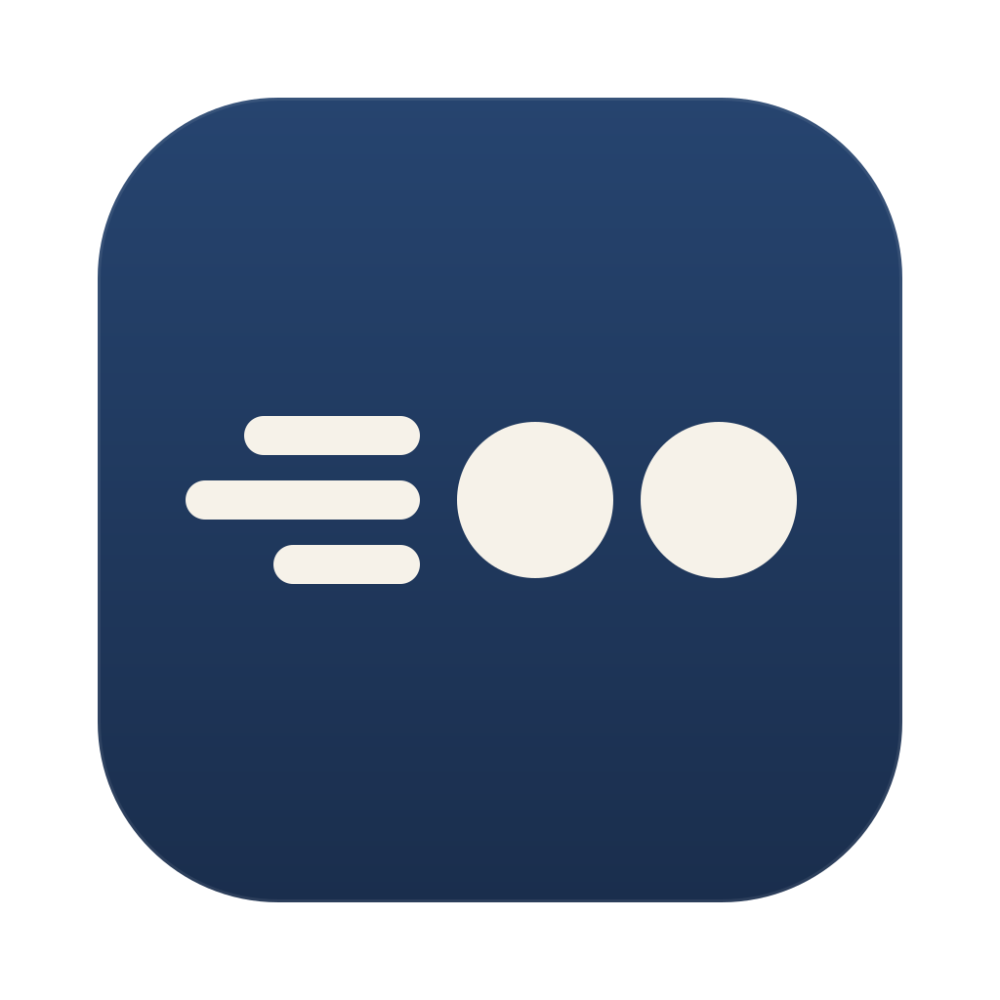

<p align="center">
  
</p>

# Swiper

Swipe between macOS desktops with an ordinary mouse.

If your MacBook sits on a stand next to an external display, the trackpad is out of reach, and the three-finger swipe goes with it. Swiper brings it back to any mouse with a left and a right button. Hold both buttons and move: the desktops follow your hand and settle when you let go, just like on the trackpad.

## What it does

| You do | Swiper does |
| --- | --- |
| Hold left + right button, move sideways | Slides between desktops and full-screen apps |
| Hold left + right button, move up | Opens Mission Control |
| Click, drag or scroll as usual | Nothing, it all works as before |

The swipe direction follows your system's natural scrolling setting. Your trackpad settings, including three-finger drag, are left alone.

## Install

1. Download `Swiper-<version>.zip` from the [latest release](https://github.com/guykongthong/swiper/releases/latest) and unzip it.
2. Move `Swiper.app` to your Applications folder.
3. Open it. macOS will block the first launch because the app is not signed with an Apple Developer ID. Go to System Settings, Privacy & Security, and click **Open Anyway** next to the Swiper message. You can also run `xattr -cr /Applications/Swiper.app` in Terminal and open it again.
4. Click the Swiper icon in the menu bar, choose **Open System Settings**, and switch Swiper on under Privacy & Security, **Accessibility**. The status changes to Active within a couple of seconds.

Swiper needs the Accessibility permission to see when both mouse buttons are held.

**Requirements:** macOS 14 or later, and a mouse with a left and a right button. It has only been tested on **macOS 27.0**. On other versions it may not work, and Settings will tell you the version is untested.

## Settings

Click the menu bar icon to turn swiping on or off, or to start Swiper at login. **Settings** has:

- **Swipe sensitivity:** how far the mouse has to move for a full swipe.
- **Click delay (30 to 50 ms):** a plain click waits this long to see if you are starting a swipe. The default is 40 ms. Lower feels snappier, but a swipe may register as a click.
- **Compatibility:** the macOS versions Swiper has been tested on, and yours.

## Known limits

- Swiping down (App Exposé) is not supported.
- The swipe relies on undocumented parts of macOS, so a macOS update can break it. If swipes stop changing desktops, the menu shows "Gesture not working" and your clicks keep working normally.
- Left and right have to be pressed within the click delay to count as a swipe.
- There is no first-run walkthrough yet.

## Build from source

You only need the Xcode Command Line Tools (Swift 6), not full Xcode.

```
scripts/test.sh      # run the unit tests
scripts/bundle.sh    # build build/Swiper.app
```

`scripts/bundle.sh` signs the app with a local certificate named "Swiper Local Signing" if you have one, so the Accessibility permission survives rebuilds. Without it, the app gets an ad hoc signature and macOS asks for the permission again after every build.

The logic (chord detection, axis lock, settings) lives in `Sources/SwiperCore` and is unit tested. The parts that touch the system (event tap, permission, gesture events, screens) are in `Sources/Swiper`.

## Docs

Notes from building it, kept in the repo:

- [`docs/srs/`](docs/srs): requirements and use cases
- [`docs/diagrams/`](docs/diagrams): component and sequence diagrams
- [`docs/adr/`](docs/adr): design decisions
- [`docs/design/`](docs/design): interface and icon mockups

## Reporting problems

Open a GitHub issue with the `defect` label and a severity: `low`, `medium`, `high` or `critical`. Include your macOS version.
